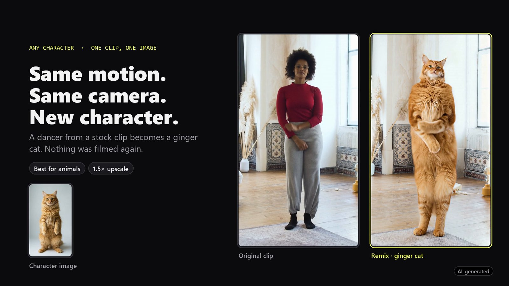
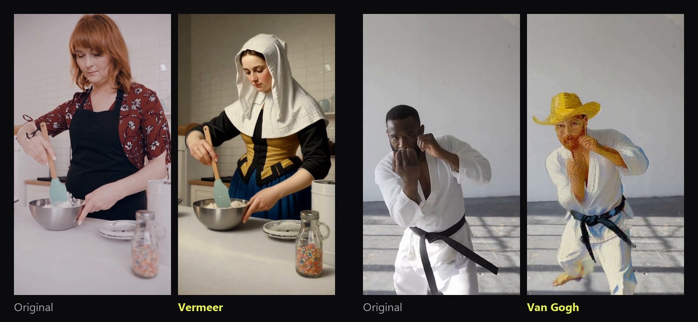
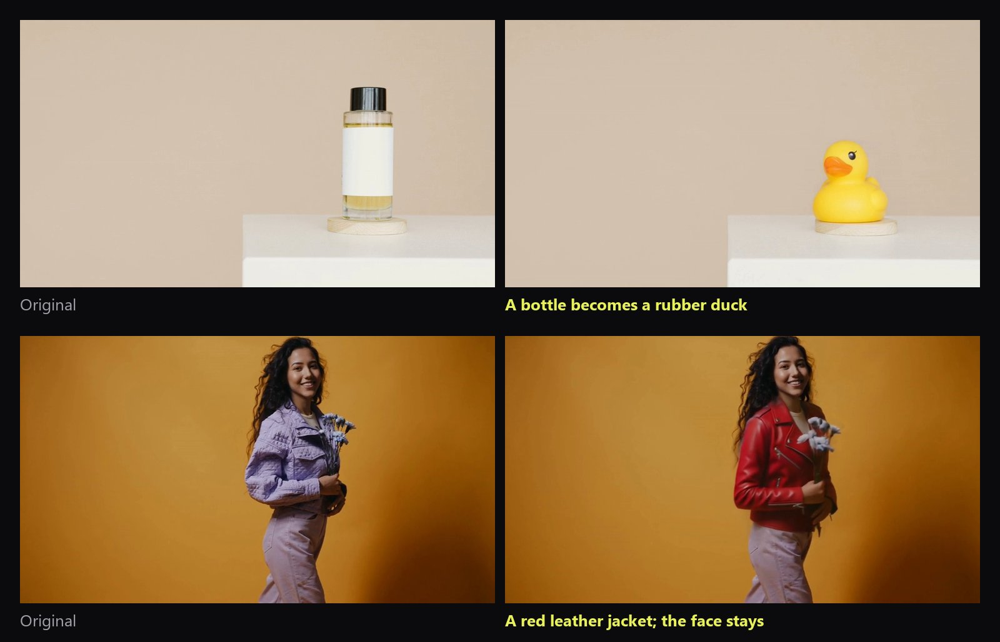
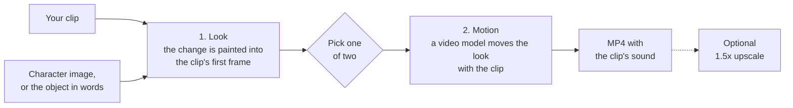
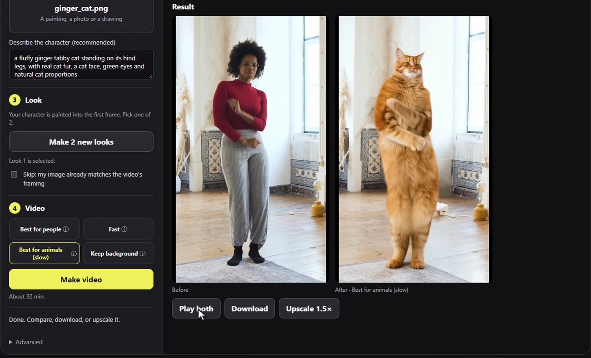

# Performance Remix



Swap the person, a pet or one object in a video clip. The clip's motion, camera and sound
stay as they were; only what you swap changes. Everything runs on your own GPU in ComfyUI
with open-weights models: no cloud API, nothing uploaded.

It comes as ComfyUI workflows you can open and run, plus a small web app that runs them
for you in four steps. Built for Comfy Org's
[Open Source Higgsfield](https://comfy.org/open-source-higgsfield) competition.

The demo in two minutes: the examples, the app from upload to result, and the workflows
behind it.

https://github.com/user-attachments/assets/b90c4268-2839-4b54-abdf-775f93af1d89

## Examples

**People and pets**: one character image, such as a painting, a photo or a drawing.



**Objects**: say what to replace and what it becomes. The new object can have another
shape, and its shadow comes with it.



All results are AI-generated. Credits are at the end.

## How it works



You approve one still image before the slow video render starts. For a person or a pet,
the look comes from Qwen-Image-Edit. For an object, SAM 3.1 first finds the old object and
hides it, so the new one is drawn in its own shape. You can also skip the look and use
your own image.

Then you choose the video model:

| Choice in the app | Model | Use it for | License |
|---|---|---|---|
| Best for people | Viggle-Animate (MiniMax H3 finetune) | sharpest faces and likeness; people only | MiniMax H3 Community License: not for local use in the US, EU, UK or South Korea without a commercial license |
| Fast | Wan2.2 Fun Control, 4 steps | trying a look; people and animals | Apache 2.0 |
| Best for animals (slow) | Wan2.2 Fun Control, 20 steps | steady fur and hair | Apache 2.0 |
| Keep background | SCAIL-2 | replaces only the person and keeps the clip's room | MIT |
| Object (one engine) | LTX-2.5 with the In/Outpainting IC-LoRA | redraws the object and its shadow; the rest is the original footage | LTX-2.x Community License |

The [node pack](https://github.com/UmutGuzel/comfyui-performance-remix) adds the nodes that make
this work:
- clips of any length render in one run;
- faces stay sharp in wide shots;
- new objects are fitted and pasted back;
- long clips are upscaled without running out of memory.

## Requirements

- **GPU**: NVIDIA with 16 GB or more. Every choice finished in tests limited to the
  memory of a 16 GB card, at most 1.4 times slower than on a 32 GB card; real 16 GB and
  24 GB cards are not tested. On smaller cards the app turns the video choices off.
- **RAM** sets the longest clip. The app reads your RAM and GPU memory from ComfyUI and
  sets one limit for people and one for objects, the same whichever choice you make:

  | RAM | 16 GB | 24 GB | 32 GB | 48 GB | 64 GB |
  |---|---|---|---|---|---|
  | People and pets, any choice | 2 s | 8 s | 15 s | 27 s | 30 s |
  | Object | none | none | 30 s | 30 s | 30 s |
  | Object, GPU under 24 GB | none | none | none | 30 s | 30 s |

  Object clips over 5 seconds are made in 5-second parts, so they need the RAM of one part
  whatever their length.

- **Disk** for the model files:

  | Part | Size |
  |---|---|
  | Look | about 31 GB |
  | Best for people | 27.6 GB |
  | Fast and Best for animals | 31 GB, plus 16.7 GB for the face pass |
  | Keep background | 19.6 GB |
  | Objects | 41.8 GB |
  | Upscale | 4 GB |

  Fast and Keep background also share about 8 GB of Wan files. Only download what you use.
- **Software**: Windows or Linux, ComfyUI 0.34 or newer, Git, Node.js 22 or newer, and
  Python 3.10 or newer for `comfy-api-proxy`.
- **Windows page file**: ComfyUI reserves 38 to 51 GB of memory during a video job. Most of
  it is never in physical RAM, but Windows needs the page file to back it, so keep the page
  file system-managed, with free space on its drive.

## Install

Steps for Windows and Linux. macOS is not supported, because the workflows need an NVIDIA
GPU. The Linux commands are not tested yet.

Three things run side by side: ComfyUI, `comfy-api-proxy` (which gives ComfyUI the Comfy
API the app talks to) and the app. Each gets its own terminal window.

### Windows

1. Install [Git](https://git-scm.com/download/win), [Node.js](https://nodejs.org) 22 or
   newer and [Python](https://www.python.org/downloads/) 3.10 or newer.

2. Download the ComfyUI portable build for NVIDIA, 0.34 or newer, from the
   [ComfyUI releases](https://github.com/comfyanonymous/ComfyUI/releases) and unpack it. It
   brings its own Python. Open PowerShell in the unpacked `ComfyUI_windows_portable` folder.

3. Add the node packs and their Python packages:

   ```powershell
   cd ComfyUI\custom_nodes
   git clone https://github.com/UmutGuzel/comfyui-performance-remix
   git clone https://github.com/Saganaki22/ComfyUI-Viggle-Animate-H3   # Best for people
   git clone https://github.com/Fannovel16/comfyui_controlnet_aux       # Fast, Best for animals
   git clone https://github.com/Lightricks/ComfyUI-LTXVideo             # objects
   cd ..\..
   foreach ($pack in "comfyui-performance-remix", "comfyui_controlnet_aux", "ComfyUI-LTXVideo") {
     .\python_embeded\python.exe -m pip install -r "ComfyUI\custom_nodes\$pack\requirements.txt"
   }
   ```

   `comfyui-performance-remix` is always needed. Leave out the other packs for choices you
   don't use, in both the clone and the install lines.

4. Download the models for the choices you want into `ComfyUI\models`.
   [docs/models.md](docs/models.md) lists every file with its folder, size and download link.

5. Start ComfyUI from the same folder and keep the window open:

   ```powershell
   $env:AIOHTTP_NOSENDFILE = '1'   # keeps ComfyUI's video downloads from stalling
   .\python_embeded\python.exe -s ComfyUI\main.py --windows-standalone-build --disable-pinned-memory
   ```

   `--disable-pinned-memory` is needed for object swaps on machines with 64 GB of RAM or
   less.

6. In a second PowerShell window, get the app and start the proxy:

   ```powershell
   git clone https://github.com/UmutGuzel/performance-remix
   cd performance-remix
   py -m venv .venv
   .\.venv\Scripts\python.exe -m pip install comfy-api-proxy
   .\.venv\Scripts\comfy-api-proxy.exe   # http://127.0.0.1:8189; keep the window open
   ```

7. In a third PowerShell window, start the app:

   ```powershell
   cd performance-remix
   Copy-Item .env.example .env.local   # the defaults point at the local proxy and ComfyUI
   npm ci
   npm run dev                         # open http://127.0.0.1:3000
   ```

   If PowerShell says running scripts is disabled, type `npm.cmd` instead of `npm`.

### Linux

1. Install Git, Node.js 22 or newer and Python 3.10 or newer.

2. Install ComfyUI 0.34 or newer with the manual install steps in its
   [README](https://github.com/comfyanonymous/ComfyUI): a Python virtual environment with
   the NVIDIA build of PyTorch. Keep that environment active for steps 3 and 5.

3. Add the node packs and their Python packages:

   ```bash
   cd ComfyUI/custom_nodes
   git clone https://github.com/UmutGuzel/comfyui-performance-remix
   git clone https://github.com/Saganaki22/ComfyUI-Viggle-Animate-H3   # Best for people
   git clone https://github.com/Fannovel16/comfyui_controlnet_aux       # Fast, Best for animals
   git clone https://github.com/Lightricks/ComfyUI-LTXVideo             # objects
   for pack in comfyui-performance-remix comfyui_controlnet_aux ComfyUI-LTXVideo; do
     pip install -r "$pack/requirements.txt"
   done
   cd ..
   ```

   `comfyui-performance-remix` is always needed. Leave out the other packs for choices you
   don't use, in both the clone and the install lines.

4. Download the models for the choices you want into `ComfyUI/models`.
   [docs/models.md](docs/models.md) lists every file with its folder, size and download link.

5. Start ComfyUI from the `ComfyUI` folder and keep the terminal open:

   ```bash
   python main.py --disable-pinned-memory
   ```

   `--disable-pinned-memory` is needed for object swaps on machines with 64 GB of RAM or
   less.

6. In a second terminal, get the app and start the proxy:

   ```bash
   git clone https://github.com/UmutGuzel/performance-remix
   cd performance-remix
   python3 -m venv .venv
   .venv/bin/pip install comfy-api-proxy
   .venv/bin/comfy-api-proxy            # http://127.0.0.1:8189; keep the terminal open
   ```

7. In a third terminal, start the app:

   ```bash
   cd performance-remix
   cp .env.example .env.local           # the defaults point at the local proxy and ComfyUI
   npm ci
   npm run dev                          # open http://127.0.0.1:3000
   ```

## Using the app



1. **Video**: upload a clip. The app uses all of it, up to your machine's limit. **Trim the
   clip** picks another part: start where the person or object is clearly in view, because
   the look is painted into that frame.
2. **What to swap**:
   - **People**: add the character image and describe it in a few words (hair, clothes,
     glasses). Without a description, the look often keeps the original face.
   - **Object**: say what to replace ("the silver car") and what it becomes ("a yellow
     pickup truck"). An image of the new object is optional.
3. **Look**: make two looks and pick one. If your image already matches the clip's
   framing, tick **Skip**. For an object, you can download the first frame, edit it in any
   image editor without cropping, and upload it.
4. **Video**: choose a model and press **Make video**. The original and the result play
   side by side, and **Upscale 1.5x** sharpens the result.

Time per second of clip on a 32 GB GPU:

| Choice | Time per second of clip |
|---|---|
| Fast | about 50 s |
| Best for people | about 75 s |
| Object | about 7 minutes per 5-second part, also for a shorter clip |
| Keep background | about 2 minutes |
| Best for animals | about 6 minutes |

Making the two looks takes about 40 s. With the memory of a 16 GB card, Fast and Best for
people took 1.3 and 1.4 times as long; Keep background and objects took about the same.

To run the app against your own Comfy API deployment of these workflows, set
`COMFY_BASE_URL` and `COMFY_API_KEY` in `.env.local`.

## Using the workflows in ComfyUI

Open the files in `workflows/editor/` in ComfyUI. The app sends the matching files in
`workflows/api/`.

| Workflow | What it does |
|---|---|
| `stage1_look.json` | paints the character or the new object into the clip's first frame |
| `stage2_motion_viggle.json` | Best for people |
| `stage2_motion_fun.json` | Fast |
| `stage2_motion_fun_detail.json` | Best for animals |
| `stage2_motion_scail2.json` | Keep background |
| `stage2_motion_object.json` | object swap, up to 5 seconds per run |
| `finish.json` | upscale and light grade of a finished video |

Run the look, then load the image you picked into a stage 2 workflow together with the
same clip. For an object clip over 5 seconds, the app runs the object workflow once per
5-second part and joins the parts with `workflows/api/join_object_windows.api.json`. [workflows/README.md](workflows/README.md) explains every setting and lists the
measurements.

## Limits

- One person or one object per clip, from 1 to 30 seconds; the result is as long as the
  part you chose.
- Object clips over 5 seconds are made in 5-second parts, each starting from the part
  before it, and joined.
- When a hand puts the object down or lets go of it, the new object can fade out as the hand
  moves away. On a test clip where a hand sets down a bottle, the rubber duck that replaced it
  stayed in 2 of 7 runs with different seeds. Clips without a hand-off, such as a car or a
  jacket, kept the new object in every test. If it happens, change the seed under
  **Advanced** and make the video again.
- Best for people cannot animate animals; use Fast or Best for animals.

## Responsible use

- Only put a real person into a video with their consent, and only use footage you have
  the rights to.
- Label results as AI-generated when you share them.
- Each model has its own license, listed in [docs/models.md](docs/models.md).
  Viggle-Animate's MiniMax H3 Community License does not cover local use in the US, EU, UK
  or South Korea without a commercial license.
- The software comes with no warranty; see the MIT [LICENSE](LICENSE).

## Repository

```
app/         Next.js pages and API routes
components/  the app's interface
lib/         workflow inputs per engine, prompts, memory limits
test/        unit tests: npm test
workflows/   editor/ for ComfyUI, api/ for the app
docs/        model list with licenses, README images
```

## License and credits

Code: MIT, see [LICENSE](LICENSE). Model licenses are separate and listed in
[docs/models.md](docs/models.md).

Example clips from Pexels:
- dancer: Kampus Production;
- cook and jacket: Pavel Danilyuk;
- karate: RDNE Stock project;
- bottle: Artem Podrez.

Paintings: Johannes Vermeer, *Young Woman with a Water Pitcher*, and Vincent van Gogh,
*Self-Portrait with a Straw Hat* (1887), The Metropolitan Museum of Art, public domain.
The cat character was made with Qwen-Image 2512.
